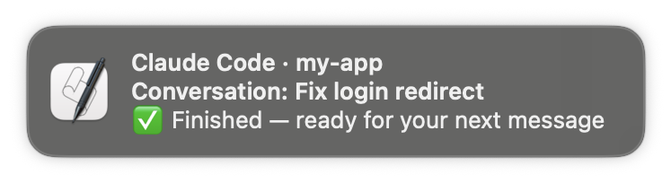
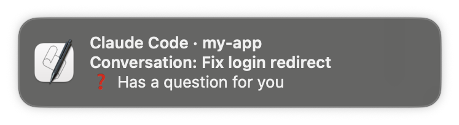
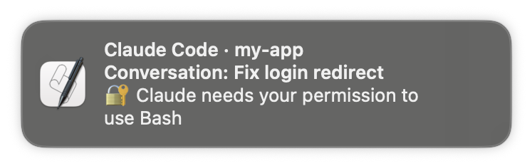

# Claude Code notifications for macOS

Get a macOS notification when Claude Code finishes a response or needs your input. Each notification names the project and the conversation, so you can tell which one needs you when you run several at once.

<p>
  
  
  
</p>

| | When | Sound |
|---|---|---|
| ✅ | A response finished | Glass |
| ❓ | Claude is asking you a question | Ping |
| 🔐 | A tool needs your permission | Ping |
| ⏳ | Claude has been waiting for your input | Ping |

- **No dependencies.** Nothing to install with Homebrew, npm or pip: the script runs with the JavaScript for Automation built into macOS's `osascript`.
- **Any terminal or IDE.** It hooks into Claude Code itself, so it works the same in Terminal, iTerm2, Ghostty, VS Code or JetBrains.
- **Tells conversations apart.** Each notification names the project and the conversation title, not just "Claude is done".
- **One-command setup.** `/macos-notifications:setup` takes care of the macOS permission step that otherwise drops notifications silently.

## Install

In Claude Code:

```
/plugin marketplace add kevinam99/claude-code-macos-notifications
/plugin install macos-notifications@claude-code-macos-notifications
```

Then run the one-time setup:

```
/macos-notifications:setup
```

### Why the setup step

macOS shows these notifications as coming from **Script Editor**. Script Editor only appears in System Settings → Notifications after it has shown a notification itself, and until it's allowed there, notifications are dropped without any error. The setup command opens Script Editor with a one-line test script; click **Run**, allow notifications if asked, and you're done.

If you'd rather do it by hand: open Script Editor (Applications → Utilities), run `display notification "hi"`, then check System Settings → Notifications → Script Editor.

Banners and Alerts both work. Alerts stay on screen until you dismiss them; with notifications set to "None", they still collect in Notification Center. A Focus mode such as Do Not Disturb can hide them.

## Settings

Set these as environment variables in the `env` section of `~/.claude/settings.json`:

```json
{
  "env": {
    "CLAUDE_NOTIFY_SOUND_DONE": "Hero",
    "CLAUDE_NOTIFY_SOUND_INPUT": "Submarine",
    "CLAUDE_NOTIFY_ON_DONE": "0"
  }
}
```

| Variable | Default | Effect |
|---|---|---|
| `CLAUDE_NOTIFY_SOUND_DONE` | `Glass` | Sound when a response finishes. `none` for silent. |
| `CLAUDE_NOTIFY_SOUND_INPUT` | `Ping` | Sound when input is needed. `none` for silent. |
| `CLAUDE_NOTIFY_ON_DONE` | on | `0` turns off the "finished" notification and keeps the input ones. |

Sound names are the files in `/System/Library/Sounds`: Basso, Blow, Bottle, Frog, Funk, Glass, Hero, Morse, Ping, Pop, Purr, Sosumi, Submarine, Tink.

## Manual install (without the plugin system)

Clone the repo somewhere permanent, then add hooks to `~/.claude/settings.json`, merging with any `hooks` you already have. Replace the path with where you cloned it:

```json
{
  "hooks": {
    "Stop": [
      {
        "hooks": [
          { "type": "command", "command": "osascript -l JavaScript \"$HOME/claude-code-macos-notifications/scripts/notify.js\"", "async": true }
        ]
      }
    ],
    "Notification": [
      {
        "matcher": "permission_prompt|idle_prompt|elicitation_dialog",
        "hooks": [
          { "type": "command", "command": "osascript -l JavaScript \"$HOME/claude-code-macos-notifications/scripts/notify.js\"", "async": true }
        ]
      }
    ]
  }
}
```

Then allow Script Editor's notifications as described in [Why the setup step](#why-the-setup-step).

## Notes

- **Conversation title.** This comes from the title Claude Code stores in the conversation transcript: a name you set with `/rename`, or the one it generates. The transcript format isn't a documented API; if it changes, notifications still appear, just without the conversation line.
- **Questions.** Claude Code reports its own questions as a permission prompt for the `AskUserQuestion` tool. The script recognises that and says "Has a question for you" instead.
- **The "finished" notification fires after every response**, including in the conversation you're looking at. Hooks can't tell which conversation is on screen.
- **macOS only.** On other systems, `osascript` doesn't exist and the hooks do nothing.

## Minimal by design

This plugin deliberately has no dependencies: it only uses what ships with macOS. The tradeoff is that notifications are sent through `osascript`, which macOS attributes to Script Editor. That brings two limitations:

- **The icon is always Script Editor's.** macOS shows the icon of the app that sent the notification, and `osascript` can't change it.
- **Clicking a notification doesn't take you to the conversation.** `osascript` notifications have no click action, so clicking one opens Script Editor (or does nothing) rather than switching to Claude Code.

Both would need a different notification sender, such as `terminal-notifier` from Homebrew or a signed helper app. That means an extra install for everyone, so they're out of scope here.

## Uninstall

```
/plugin uninstall macos-notifications@claude-code-macos-notifications
```

## Development

`tests/run.sh` runs the script in dry-run mode (`CLAUDE_NOTIFY_DRY_RUN=1`) against sample hook inputs and checks the title, subtitle, message and sound it would show.

To try a real notification:

```sh
echo '{"hook_event_name":"Stop","cwd":"'"$PWD"'"}' | osascript -l JavaScript scripts/notify.js
```

## Other platforms

The same notifications are also available for other systems:

- **Linux:** [claude-code-linux-notifications](https://github.com/kevinam99/claude-code-linux-notifications)
- **Windows:** [claude-code-windows-notifications](https://github.com/kevinam99/claude-code-windows-notifications)

## License

[MIT](LICENSE)
